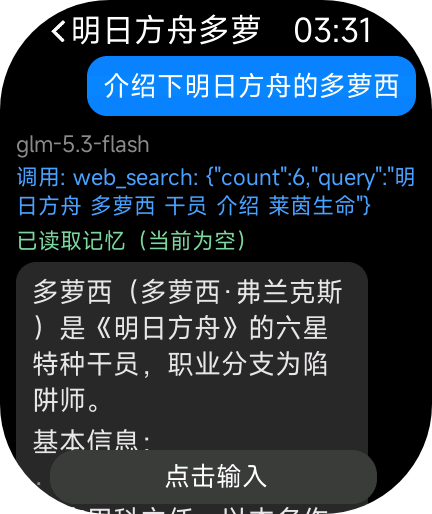
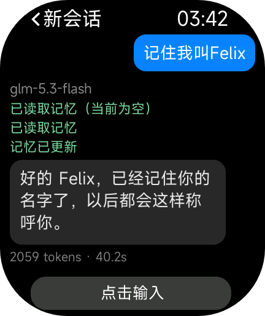
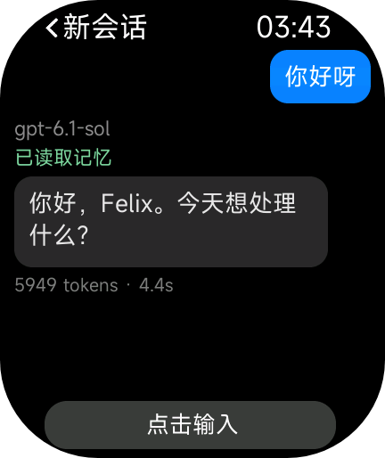
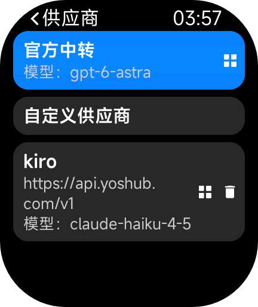
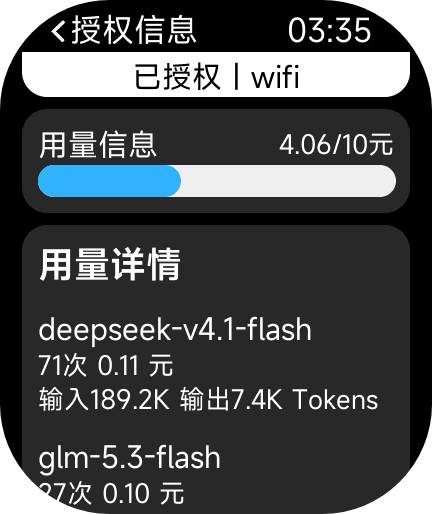
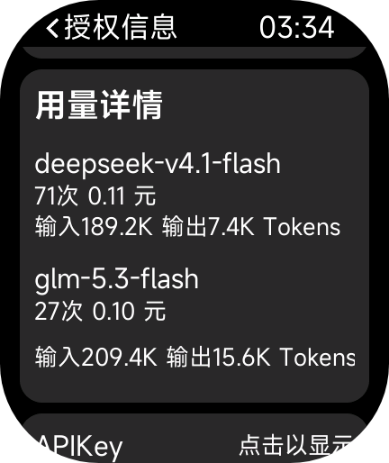

智能手表已经能测心率、看通知、记录运动。

但真正需要一句话就解决的事——写一段文案、整理一份清单、查一条刚发布的公告——还是得掏出手机。

**Eclipse 星语，就是为了把这件事搬到手腕上。**

它是一款可以独立运行在小米 Vela 设备上的 AI 对话快应用，把大语言模型直接装进手表，并把文件系统、设备控制、网络与时间等能力封装成结构化工具交给 AI 调用。

你不只是在和它聊天。

---

## 先解决联网这件事

对话要跑起来，网络是前提。

多数支持 eSIM 的手表，装上就能直接用。

但有一部分设备被识别为**硬件层面无法直接联网**，小米手环 10 Pro 就在其中。

对这类设备，我们此前做的 **SimpleFetch** 可以补上这块能力。它是 AstroBox 上的网络桥接插件，激活后由它在中间代发网络请求，手环本身不具备联网条件也能正常对话。

**如果你使用的正是无法单独联网的型号，先装 SimpleFetch，再打开 Eclipse 星语。**

其余型号不需要这一步，直接安装即可。

---

## 它会自己去查，也会自己记住

模型的训练数据总有截止时间，而问题往往就在今天。

Eclipse 星语支持联网搜索。遇到需要最新信息的问题时，AI 会先调用 `web_search` 到网上检索，再把手腕上这方屏幕当作回答窗口。

搜索的过程是看得见的，状态行会如实记录它做了什么。

它也能记住你。

**一句话写下的事，下一个会话开场它就已经知道。**

每个新会话的第一条消息，AI 都会先读一次记忆。你只要说过一次“记住我叫 Felix”，再新开一个会话，它开口的第一句话就已经带上了你的名字。

记忆跨会话生效，受硬保护、AI 无法删除，但内容可以随时更新。记什么、记不记得住，决定权始终在你手里。

---

## 标题也不用自己整理

对话多了，会话列表总会变得一团乱。

Eclipse 星语会跟着聊天内容，在后台自动为会话命名：第一条消息回复完成后起一次标题，之后每完成 5 轮再更新一次。

顶部标题栏会先短暂显示“已自动命名”，再切换成新名称。整个过程静默完成，不打断对话，聊天记录里也不会多出一条无用内容。

---

## 用哪个模型，你说了算

Eclipse 星语不绑定任何一家模型。

官方中转开箱即用，会持续同步当前可用的模型。每次拉取都会把本地列表完整对齐服务端——下线的旧模型自动清掉，不会留下一个点了没反应的选项。

你也可以完全不用官方线路，自己填服务地址与密钥，走兼容 OpenAI 协议的任何服务。同一个问题换一个模型，往往就是另一种回答风格。

付费方式是**买断制结合按量计费**：一次买断即可长期使用，官方中转的调用按 Token 计费，同时保留了可以白嫖的免费模型。

---

## 花了多少，看得见

AI 应用最容易让人心里没底的，是“不知道花了多少钱”。

Eclipse 星语把额度与用量直接摊开在授权信息页里：当前额度、联网状态一眼可见，还能细分到每个模型——调用过多少次、花了多少钱、输入输出了多少 Token。

**看得见的消耗，才是用得放心的前提。**

---

## 能放手，也收得住

能力越强，风险越具体。

Eclipse 星语为 AI 划了几道边界：每个会话拥有独立的工作区，AI 默认只能读写自己的地盘，跨出边界一律弹出确认框；应用数据目录对 AI 完全不可见；登录密钥不明文落盘。

审批模式分为**手动、智能、绕过**三档。手动逐次确认，智能放行只读操作，绕过则全部放手——选到高风险档位时，界面会以醒目的橙色提醒你，而且只对当前会话生效。

脚本执行同样有独立的隔离环境，危险写法会被静态扫描拦下，定时器与内存都有上限。

**既能玩得开，也摔不坏。**

---

## 抬腕就有回应

Eclipse 星语不是被规划出来的庞大工具集。

先是想在手表上问一句 AI，然后希望它能记住我，再然后希望它真的能动手做点什么——功能是一个个长出来的。

模型有没有记忆，决定了对话能不能延续；能不能联网，决定了回答跟不跟得上时间；有没有边界，决定了你敢不敢把它长期戴在手上。

**让复杂的能力更容易抵达，让每一次抬腕都有回应。**

这是 Eclipse 星语继续往前走的方向。

---

## 2.0，代号 Eidos

1.0 的代号是 Helios。它把大模型装进手表，让 AI 能查、能记，也能动手做事。

但把能力搬上手腕，只是第一步。

2.0 的代号是 **Eidos**。在希腊语里，它既是「形式」，也是「理念」。

Eidos 要做的，不只是把现有界面打磨得更精致。整体 UI 会有一次比较大的改进，而更关键的变化在于：界面不再被提前写死。

它计划实现实时生成 UX 并完成渲染。你提出需求，AI 当场生成一套适合这块屏幕的界面，并把它渲染出来；生成之后，你可以点击、输入、滑动，与它继续交互。

不是先设计好每一个页面，再让 AI 往里填内容，而是让界面跟着对话一起长出来。

这也是 Eclipse 星语一直想靠近的方向：让复杂的能力更容易抵达，让每一次抬腕都有回应。

当界面本身也能被即时创造，手表上能做的事，就不再局限于应用商店里已经存在的那些。

::resource{id=moe.mcns.Eclipse}
